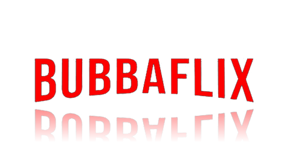

<p align="center">
  
</p>

# BubbaFlix 🎬 - Movie & TV Show Streaming & Discovery App (v1.0.29)

BubbaFlix is a modern, high-performance movie and TV show streaming discovery platform built with **React 18**, **Redux Toolkit**, **React Router v6**, **Vite**, **Pure Node.js**, **Native Android TV (Kotlin / ExoPlayer)**, **Torrent Stream Scraper & Premiumize Debrid**, **TMDB**, **Groq AI**, and **SIMKL**.

BubbaFlix features **↕️ Home Page Vertical Viewport Scrolling & Edge Navigation Engine (v1.0.29)**, **🛡️ Client & Server Dynamic Cache Invalidation Engine (v1.0.28)**, **🔍 Comprehensive Multi-Endpoint TV & Movie Search (v1.0.28)**, **📺 Prime-Time "On The Air" Carousel Prioritization (v1.0.28)**, **📺 Explore TV Series "On The Air" & "Airing Today" Sorts (v1.0.27)**, **🛡️ Adult Filter Precision Engine (v1.0.27)**, **🕹️ Remote D-Pad Repeat Throttle & Dynamic Instant Scroll (v1.0.27)**, **🔍 Search Bar Interactive Unlock & Multi-Device Editing (v1.0.26)**, **⬆️ Smart Remote "Back to Top" & Home Key Navigation (v1.0.26)**, **📺 TMDB "On The Air" Expanded Airing Engine (v1.0.26)**, **🚀 Portal-Rendered Full-Viewport Transparent Poster Action Menu**, **📺 TMDB "On The Air" & "Airing Today" TV Carousels**, **⚡ Android TV ExoPlayer 64MB Buffer Cap & OOM Defense**, **🎯 Persistent Explore & Favorites Sort Retention**, **🔄 TV Series Episode Refresh Focus & Scroll Restoration**, **📱 Touchscreen & Tablet Scroll Guard**, **🔥 Fire Tablet 10-bit HEVC Server Transcode Fallback**, **🎬 Player Progress Bar D-Pad Focus Lock**, **📺 Remote Back Button Details & Modal Navigation Engine**, **⚡ Persistent 30-Day Poster & Image Cache**, **🎬 Movie Details Scroll Reset & D-Pad Spatial Navigation Engine**, **🎯 Navigation Focus Retention & Non-Poster Page Auto-Focus**, **🎬 YouTube Trailer Embed Bot Bypass & TV D-Pad Focus Release**, **📺 ExoPlayer Smart Back & Control Auto-Hide**, **🎭 Refined Actor Search & Filmography Engine**, **⚡ Android TV Local Poster & Metadata Caching (`WebSettings.LOAD_DEFAULT`)**, **📦 Stream Droplist Category & Layout Manager Container Cards**, **⚡ Server-Side TMDB & Explore Metadata Caching Engine (`/api/tmdb/*`, `/api/explore/*`)**, **🔍 Dedicated Interactive Search Page (`/search`)**, **⭐ Favorites Section & Star Toggle Persistence**, **Native Android TV App (`android-tv/`) with ExoPlayer 64MB Buffer & Automatic Server Settings Inheritance**, **Automatic Web Audio Transcoder (AC3/EAC3/DTS → AAC) with FFprobe Multi-Language Audio Extraction**, **Customizable & Syncable Home Screen Layouts**, **Unlocked Smart TV D-Pad Spatial Navigation with Focus Retention**, **Canonical OTA Version Updates (`version.json`)**, **Groq AI Llama 3 Stream Title Filtering**, **Official SIMKL Watch History Sync**, and **Centralized Backend Transcoder Proxy**.

---

## 📲 Downloader App Quick Install

Install **BubbaFlix TV** directly on any Firestick, Fire TV, or Android TV device using the **Downloader** app:

> 🔥 **Downloader Code**: **`7862216`**
> 
> 🔗 **Direct APK URL**: `https://raw.githubusercontent.com/jsanderstechnologies/BubbaFlix/master/BubbaFlixTV.apk`

---

## 🌟 Key Features

### ↕️ Home Page Vertical Viewport Scrolling & Edge Navigation Engine (`v1.0.29`)
- **Restored Home Page Vertical Scrolling**: Resolved an issue where remote D-pad navigation across carousel rows suppressed native browser scrolling via `preventScroll: true` without performing vertical viewport adjustments, leaving the screen locked at `scrollY = 0`.
- **Intelligent Edge & Page-Jump Scrolling**: Actively measures element bounding rects against viewport boundaries and top header clearances, automatically scrolling just enough to bring newly focused cards and section titles into full view during single steps, page jumps, or continuous key repeats.
- **Overlay Modal Protection**: Strictly isolates overlay dialogs (`PosterActionModal`, `SortModal`, `CustomizeModal`) from background window scroll drift.
- **Memoized Section Subcomponents**: Decomposed `DynamicSection` into dedicated subcomponents with `useMemo` caching on sorted results, strictly obeying React Rules of Hooks and eliminating re-render churn.

### 🛡️ Client & Server Dynamic Cache Invalidation Engine (`v1.0.28`)
- **Eliminated 30-Day Stale Cache Lock**: Resolved an issue where `/api/tmdb/*` API responses previously emitted `max-age=2592000, immutable`, causing browsers and Android TV WebViews to permanently cache old empty results on device disk for 30 days without revalidating.
- **Revalidation & Short TTL**: Set dynamic API `Cache-Control: public, max-age=300, must-revalidate` and added client-side `_v=1.0.28` query versioning with `no-cache` request headers, ensuring client devices instantly bypass any previously stuck cache.
- **Empty Result Guard**: The server now refuses to persist empty result arrays (`results: []`) to the 30-day disk cache, preventing temporary network glitches or filter misses from polluting long-term cache.

### 🔍 Comprehensive Multi-Endpoint Search & Fallback Engine (`v1.0.28`)
- **Direct Multi + TV + Movie Querying**: Searches now concurrently query TMDB `/search/multi`, `/search/tv`, and `/search/movie`, guaranteeing that specific TV series with special characters, apostrophes, or ampersands (*Georgie & Mandy's First Marriage*) are reliably surfaced.
- **Media Type Auto-Classification**: Added robust title-name heuristics to guarantee media cards without explicit `media_type` tags are always properly routed into TV Shows or Movies tabs.

### 📺 Prime-Time "On The Air" Carousel Prioritization (`v1.0.28`)
- **Smart Ranking for Airing Shows**: Re-ranked shows in the "On The Air" carousel to prioritize modern, high-rated broadcast hits near the front of the horizontal slider, ensuring current-week broadcasts like *Georgie & Mandy's First Marriage* appear in the initial view rather than buried at position 76.

### 📺 Explore TV Series "On The Air" & "Airing Today" Sorts (`v1.0.27`)
- **Direct Airing Sort Options**: Added dedicated sort options `TV Shows On The Air` and `TV Shows Airing Today` directly into the Explore TV Series dropdown.
- **Dynamic Endpoint Routing & Infinite Scroll**: Routes queries seamlessly to `/tv/on_the_air` and `/tv/airing_today` with automatic page-by-page infinite scrolling as users browse.
- **Session Sort Retention**: Retains the chosen sort mode in `sessionStorage` when navigating into series details and seamlessly restores it when pressing back.

### 🛡️ Adult Filter Precision & Title Restoration (`v1.0.27`)
- **Word-Boundary Regex Matching**: Replaced raw substring matching in the backend proxy (`server/transcoder.cjs`) with strict regex and word-boundary rules (`PORN_OVERVIEW_REGEX_SERVER` and `PORN_TITLE_KEYWORDS_SERVER`).
- **Eliminated False Positives**: Fully eliminates false-positive blocking of family and general-audience content containing words like "adulthood", permanently resolving search and carousel omission for titles such as *Georgie & Mandy's First Marriage*.

### 🕹️ Remote D-Pad Repeat Throttle & Dynamic Instant Scroll (`v1.0.27`)
- **Key Repeat Throttling**: Added a 110ms pacing throttle (`NAV_REPEAT_THROTTLE_MS`) for rapid key repeats, preventing the event loop from being flooded when holding down directional D-pad or Page Up/Down buttons.
- **Dynamic Instant Scrolling**: Automatically switches scroll behavior from `smooth` to `auto` during rapid key repeats, preventing browser smooth-scroll animation queueing and mid-scroll bounding rect miscalculations that caused visual jitter and focus jumping.
- **Safe Poster Focus Retention**: Removed delayed 150ms focus re-theft timers in `focusManager.js`, ensuring currently focused cards retain clean visual highlight without race conditions.

### 🔍 Search Bar Interactive Unlock & Multi-Device Editing (`v1.0.26`)
- **Interactive Re-Editing**: Resolved an issue where executing a search previously locked the search input into a `readonly` state across desktop, tablet, and TV environments. Users can now click, tap, or navigate back to the search bar to immediately edit, append, backspace, or clear queries without needing to leave the page.
- **TV D-Pad & Soft Keyboard Toggle**: Android TV users can press OK / Enter on their remote while focused on the search input to instantly bring up the on-screen soft keyboard. When actively typing, pressing Enter dismisses the TV soft keyboard cleanly without blurring or disabling the input.
- **TV-Only Soft Keyboard Suppression**: Confined soft keyboard suppression exclusively to TV remote navigation (`isTvEnvironment()`) with capture-phase pointer activation, ensuring desktop PCs and tablets with mouse or physical keyboards are never forced into `readonly` mode.
- **Protected Poster Focus Restoration**: Added active input guards to `focusManager` and search results so that newly loaded or streaming search results never steal focus away from the search bar while the user is typing.

### ⬆️ Smart Remote "Back to Top" & Hybrid Navigation (`v1.0.26`)
- **Remote Home Key Support**: Pressing the remote `Home` key anywhere on the page smoothly scrolls to the top (`window.scrollTo({ top: 0, behavior: "smooth" })`) and focuses the active top navigation button.
- **Hybrid Back-to-Top Navigation**: When scrolled deep down a long catalog or explore page (`scrollY > 400`), pressing the TV remote `Back` button smoothly returns the user back to the top of the page first rather than immediately exiting the screen.

### 📺 TMDB "On The Air" Multi-Page Expanded Window (`v1.0.26`)
- **Multi-Page Querying**: Expanded the "On The Air" carousel to query across multiple TMDB pages and filter by a rolling 7-day airing window, ensuring all currently broadcasting and upcoming series (such as *Georgie & Mandy's First Marriage*) are reliably surfaced.
- **Adult Keyword Precision**: Replaced greedy substring matches with word-boundary matching on adult filters, preventing false-positive blocking of general audience titles containing terms like "adulthood".

### 🚀 Portal-Rendered Transparent Poster Action Menu (`v1.0.25`)
- **Full Viewport Portal**: The long-press poster modal is rendered via `createPortal(..., document.body)`, completely detaching it from transformed poster card containers and ensuring 100% accurate full-screen viewport coverage across all screen sizes.
- **Transparent Backdrop**: Replaced dark smoky background blur with a completely transparent click-to-dismiss backdrop, keeping the underlying content visible while the quick action dialog stands out crisply.
- **D-Pad Spatial Navigation**: Center-key long-press (400ms) or context-menu trigger pops up the menu with instant focus on the first action and seamless `ArrowUp` / `ArrowDown` spatial cycling between Favorites, SIMKL Watch status, and Details.

### 📺 TMDB "On The Air" & "Airing Today" TV Carousels (`v1.0.25`)
- **Dedicated TV Sections**: Added a new **On The Air** section (`/tv/on_the_air`) to the customizable home page layout alongside **Current TV Episodes** (`/tv/airing_today`), giving users separate access to shows airing within the next 7 days vs episodes airing today.
- **Fully Customizable**: Can be enabled, disabled, or reordered via the Home Screen Layout Customizer.

### ⚡ Android TV ExoPlayer 64MB Buffer Cap & OOM Defense (`v1.0.25`)
- **64MB Ahead-Buffering**: Tuned `DefaultLoadControl` in `PlayerActivity.kt` with a 64MB buffer cap (`64 * 1024 * 1024`) and 300-second buffer-ahead window to prevent micro-stutters and buffer underruns on 4K/1080p high-bitrate media.
- **`largeHeap="true"` & Background WebView Pausing**: Added Android large heap support and automatic WebView pause/memory trimming when launching ExoPlayer to safeguard lower-memory devices against OOM crashes.
- **Crash Guards**: Implemented defensive thread crash guards and safe playback teardown routines.

### 🎯 Persistent Sort & Tab Retention on Details Exit (`v1.0.25`)
- **Explore & Favorites Memory**: User sort selections (Popularity, Rating, Release Date, Title) and active sub-tabs (Movies vs Collections) in Explore and Favorites are stored in `sessionStorage` and preserved when backing out of media details.
- **Page-Reload Poster Focus**: When navigating back from a details screen, the app waits for carousel and grid sections to finish reloading before restoring D-pad focus and scroll position directly to the previously selected poster.

### 🔄 TV Series Episode Refresh Focus & Scroll Restoration (`v1.0.25`)
- **Scroll & Focus Preservation**: Refreshing streams inside a TV series episode saves the current viewport scroll position and episode button ID, returning focus directly to the refreshed dropdown upon reload instead of bouncing to the page's top back button.
- **Spinning Refresh Icon**: Visual feedback indicator with smooth animation while streams are actively refetched.

### 📱 Touchscreen & Tablet Touch Discrimination (`v1.0.25`)
- **Swipe-Safe Scrolling**: Distance and velocity detection prevents touchscreen swipes on phones and tablets from accidentally firing long-press menus or opening details pages.
- **🔥 Fire HD10 10-bit HEVC Fallback**: Client device detection flags devices without hardware 10-bit HEVC decoding capabilities (e.g. Fire HD10 tablets) and routes them through the server transcode pipeline to prevent player crashes.

### ⚡ Android TV Local Poster & Metadata Caching (`WebSettings.LOAD_DEFAULT`)
- **Native Device HTTP Caching**: Android TV client uses `WebSettings.LOAD_DEFAULT` to store TMDB poster images and JSON metadata directly on device disk storage.
- **Fast Load Times & Reduced Bandwidth**: Images persist with long-term 1-year TTL and metadata responses persist with 1-hour TTL, matching backend server retention policies.

### 🎭 Refined Actor Search & Filmography Engine
- **Actor Query Classification**: Searching for an actor (e.g. *"John Wayne"*, *"Clint Eastwood"*, *"Tom Hanks"*) automatically resolves their exact TMDB profile and loads their complete filmography (`/person/{id}/combined_credits`).
- **Strict Multi-Token Person Filtering**: When searching actor names, person entries are strictly required to match **all** query tokens (e.g. both *"John"* and *"Wayne"*), filtering out unrelated single-token names like *"John Smith"* or *"Wayne Brady"*.
- **Filmography Categorization & Deduplication**: Filmography results are deduplicated by ID and sorted into **Feature Movies**, **TV Series**, and **Documentaries & Specials**.

### 📦 Stream Dropdown & Layout Manager Container Cards
- **Initial Closed State**: Streams dropdown on details pages starts out closed with real-time count badges (*{count} Streams Found*, *Searching...*, *0 Streams Found*, *Setup Required*).
- **Category & Layout Manager Styling**: Stream results are rendered in dedicated card containers matching the Settings Category & Layout Manager card style.
- **Theme Variable Controls**: Dynamic app theme colors (`var(--pink)`, `var(--gradient)`, `var(--black3)`) with D-pad TV focus and hover glow states.

### 🌐 Server-Side Explore & TMDB Metadata Proxy (`/api/explore/*`, `/api/tmdb/*`)
- **High-Volume Explore Pages**: Movies and TV Shows explore pages load extended items served and cached directly by the backend server.
- **Persistent Disk & RAM Cache**: Fast responses with background caching for popular titles, genres, and trending categories.

### 🔍 Dedicated Interactive Search Page (`/search`)
- **Interactive Search Page**: Standalone menu item and dedicated route (`/search`) with a large, auto-focused D-Pad input bar.
- **Category Filter Chips**: 1-click filter between **All Results**, **Movies Only**, and **TV Series Only**.
- **Popular Search Suggestions**: 1-click search tags (*Action*, *Comedy*, *Marvel*, *Sci-Fi*, *Horror*, *Drama*, *Animation*, *Thriller*).
- **Focus Retention**: Spatial D-Pad navigation retains input focus while typing until you explicitly press Down to browse the results grid.

### 📺 Native Android TV, Google TV & Fire TV App (`android-tv/`)
- **Downloader Quick Install**: Enter code **`7862216`** in the Downloader app to install `BubbaFlixTV.apk` directly on your TV.
- **Single Clean Build Name**: Builds directly to `BubbaFlixTV.apk` without cumbersome version suffixes.
- **ExoPlayer Ahead-Buffering Engine**: ExoPlayer (`PlayerActivity.kt`) buffers up to 64MB / 300 seconds ahead with `DefaultLoadControl` to eliminate micro-stutters and video freezing on high-bitrate 4K / 1080p streams.
- **Canonical OTA Update Checker**: Automatically checks `version.json` on app launch and prompts the user with an interactive update notification.
- **Native Android TV Launcher Banner**: Includes full Leanback launcher integration (`LEANBACK_LAUNCHER`) for Android TV, Google TV, Chromecast, Nvidia Shield, and Amazon Fire TV devices.

### ⭐ Favorites Section & Persistence
- **Dedicated Favorites Page (`/favorites`)**: View all saved favorite movies and TV series in one centralized location with filter tabs (**All**, **Movies**, **TV Series**).
- **Details Screen Star Toggle (`FavoriteStar`)**: Toggle items in and out of Favorites directly from their details screen with instant visual feedback.

### 🔊 Automatic Web Audio Transcoder & Nginx Engine
- **Universal Audio Codec Transcoding**: Web browsers lack native decoders for AC3 (Dolby Digital), EAC3 (Dolby Digital Plus), TrueHD, and DTS audio tracks. The backend FFmpeg engine (`/api/transcode`) automatically converts unsupported audio into standard stereo AAC (`-c:a aac -b:a 192k -ac 2`), guaranteeing clear, loud audio across all web browsers.
- **Nginx Transcoder Proxy**: Pre-configured in `nginx.conf` (`proxy_pass http://127.0.0.1:5000;`) for unbuffered real-time video/audio streaming.

---

## ⚙️ Docker / Portainer / CasaOS Environment Variables

Pre-configure your API credentials directly in `docker-compose.yml`, Portainer Stacks, or CasaOS container settings:

| Environment Variable | Description | Default Value |
| :--- | :--- | :--- |
| `PREMIUMIZE_API_KEY` | Premiumize Debrid API Key | `""` |
| `SIMKL_CLIENT_ID` | SIMKL API Client ID | `""` |
| `GROQ_API_KEY` | Groq AI Stream Filter API Key | `""` |
| `TMDB_READ_ACCESS_TOKEN` | TMDB v4 Read Access Token | Built-in fallback |

Settings persist across container restarts using the Docker volume mapping: `bubbaflix-data:/app/server`.

---

## 📱 Android TV APK Build & Deployment

- **Downloader App Code**: **`7862216`**
- **Canonical APK Download**: [`BubbaFlixTV.apk`](https://raw.githubusercontent.com/jsanderstechnologies/BubbaFlix/master/BubbaFlixTV.apk)
- **Version Check JSON**: [`version.json`](https://raw.githubusercontent.com/jsanderstechnologies/BubbaFlix/master/version.json)

To build the native Android TV APK manually:
```bash
cd android-tv
$env:JAVA_HOME = "C:\Program Files\Android\Android Studio\jbr"
.\gradlew.bat assembleRelease
```
See [`android-tv/README.md`](file:///f:/Cyberflix/android-tv/README.md) for step-by-step sideloading & installation guides.

---

Made with ❤️ by [jsanderstechnologies](https://github.com/jsanderstechnologies).
